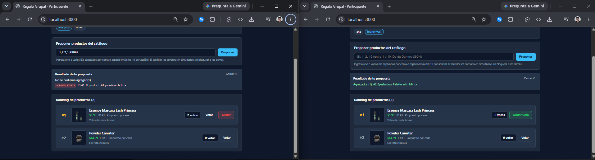
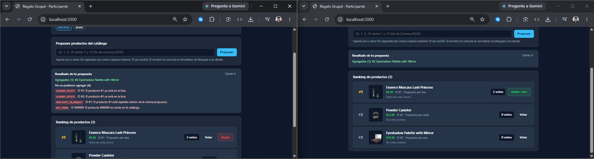
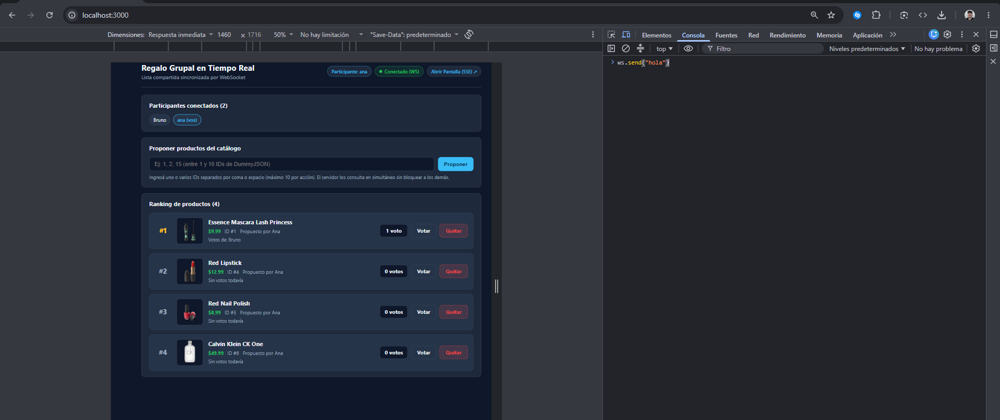
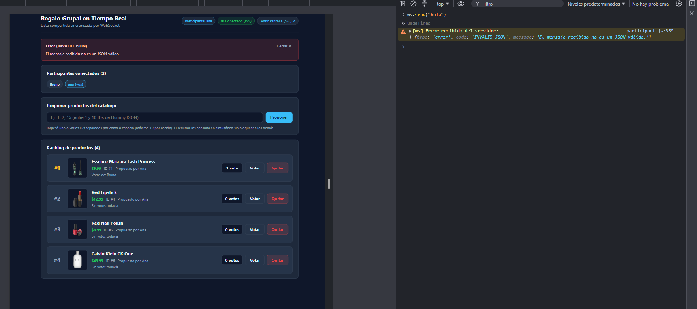

# TP4 · Asincronismo e integración con Node.js y TypeScript

Aplicación web en tiempo real para coordinar la compra de un **regalo grupal**: varios participantes se conectan desde su navegador para proponer productos del catálogo externo de [DummyJSON](https://dummyjson.com/docs/products) y votar sus favoritos, mientras una pantalla compartida (TV o proyector) muestra el ranking actualizado en vivo sin recargar.

Todo corre en **un único servidor Node.js + TypeScript sobre un mismo puerto**, sin base de datos (estado en memoria), usando **WebSocket estándar** (`ws` / `WebSocket` nativo, sin Socket.IO) para los participantes y **Server-Sent Events** (`EventSource`) para la pantalla.

---

## 1. Instalación y ejecución

### Requisitos
* **Node.js LTS** (probado con Node.js `v22.11.0`) y `npm`.

### Instalación
```bash
npm install
```

### Configuración (variables de entorno)
Podés copiar `.env.example` a `.env` o pasar las variables directamente por terminal (las variables de terminal siempre tienen prioridad sobre `.env`):

| Variable | Por defecto | Descripción |
|---|---|---|
| `PORT` | `3000` | Puerto único del servidor HTTP, WebSocket (`/ws`) y SSE (`/events`). |
| `CATALOG_BASE_URL` | `https://dummyjson.com/products` | URL base del catálogo externo de productos. |
| `CATALOG_TIMEOUT_MS` | `3000` | Tiempo máximo de espera (ms) por consulta al catálogo externo. |
| `CATALOG_DELAY_MS` | `0` | Demora artificial (ms) enviada a DummyJSON como `?delay=<ms>` para simular lentitud sin tocar el código *(DummyJSON acepta valores de `0` a `5000` ms)*. |

### Comandos de ejecución

* **Modo desarrollo (recarga automática con `tsx`):**
  ```bash
  npm run dev
  ```
* **Compilación y ejecución en producción (`tsc` + `node`):**
  ```bash
  npm run build
  npm start
  ```
* **Verificación de tipos TypeScript:**
  ```bash
  npm run typecheck
  ```

### Cómo simular catálogo lento o timeouts sin modificar el código

* **Catálogo lento (responde antes del timeout, para observar votación sin bloqueos):**
  * PowerShell:
    ```powershell
    $env:CATALOG_DELAY_MS="3500"; $env:CATALOG_TIMEOUT_MS="5000"; npm run dev
    ```
  * Bash / Linux / macOS:
    ```bash
    CATALOG_DELAY_MS=3500 CATALOG_TIMEOUT_MS=5000 npm run dev
    ```
* **Catálogo con timeout (supera el límite máximo de espera):**
  * PowerShell:
    ```powershell
    $env:CATALOG_DELAY_MS="3500"; $env:CATALOG_TIMEOUT_MS="1000"; npm run dev
    ```
  * Bash / Linux / macOS:
    ```bash
    CATALOG_DELAY_MS=3500 CATALOG_TIMEOUT_MS=1000 npm run dev
    ```

### Rutas del servidor
* **Participante (WebSocket):** `http://localhost:3000/`
* **Pantalla en vivo (SSE):** `http://localhost:3000/pantalla` *(alias: `/screen`)*
* **Endpoint WebSocket:** `ws://localhost:3000/ws`
* **Endpoint SSE:** `http://localhost:3000/events`

*(Tip para pruebas: en la vista de Participante el socket queda expuesto en `window.ws`, por lo que se pueden enviar mensajes inválidos directo desde la consola de DevTools, por ejemplo `ws.send("hola")` o `ws.send(JSON.stringify({ type: "invalido" }))`).*

---

## 2. Estructura del proyecto

```text
├── public/
│   ├── index.html          # Interfaz del participante (WebSocket nativo)
│   ├── participant.js      # Lógica cliente del participante (vanilla JS)
│   ├── screen.html         # Interfaz de la pantalla compartida (solo lectura)
│   ├── screen.js           # Suscripción EventSource / SSE (vanilla JS)
│   └── styles.css          # Estilos compartidos
├── src/
│   ├── config.ts           # Carga y validación fail-fast de variables de entorno
│   ├── types/
│   │   └── protocol.ts     # Contrato tipado de mensajes WS y eventos SSE
│   ├── validation/
│   │   └── messageValidator.ts # Validación en runtime de JSON, rangos y nombres
│   ├── services/
│   │   ├── catalogService.ts   # Consultas paralelas a DummyJSON con timeout y cancelación
│   │   └── giftListStore.ts    # Estado en memoria, ranking determinista y autorización
│   ├── transport/
│   │   ├── wsHandler.ts    # Ciclo de vida WebSocket, broadcasts y limpieza de sesiones
│   │   └── sseHandler.ts   # Streams SSE (/events), snapshot inicial y limpieza al cerrar
│   └── server.ts           # Servidor HTTP único (estáticos + /events + upgrade /ws)
└── docs/evidencias/        # Capturas y videos de verificación
```

---

## 3. Contrato de mensajes

Todos los mensajes intercambiados por WebSocket y los payloads de los eventos SSE son objetos **JSON** tipados en [`src/types/protocol.ts`](src/types/protocol.ts).

### 3.1 Objetos de datos compartidos

#### `ProductItem` (enviado a participantes)
```json
{
  "id": 1,
  "title": "Essence Mascara Lash Princess",
  "price": 9.99,
  "image": "https://cdn.dummyjson.com/product-images/beauty/essence-mascara-lash-princess/thumbnail.webp",
  "proposedBy": "Ana",
  "votesCount": 2,
  "voters": ["Bruno", "Carla"],
  "addedAt": 1763911200000
}
```

#### `ScreenProductItem` (enviado a la pantalla SSE — sin detalle individual de votantes)
```json
{
  "id": 1,
  "title": "Essence Mascara Lash Princess",
  "price": 9.99,
  "image": "https://cdn.dummyjson.com/product-images/beauty/essence-mascara-lash-princess/thumbnail.webp",
  "proposedBy": "Ana",
  "votesCount": 2
}
```

---

### 3.2 WebSocket · Participante → Servidor (`ws://localhost:3000/ws`)

| `type` | Dirección | Campos | Cuándo se envía |
|---|---|---|---|
| `join` | Cliente → Servidor | `name: string` *(2 a 20 caracteres tras limpiar espacios)* | Al ingresar por primera vez para identificarse y entrar a la lista compartida. |
| `propose_products` | Cliente → Servidor | `productIds: number[]` *(1 a 10 enteros positivos seguros)*, `requestId?: string` *(opcional, máx. 64 chars)* | Cuando un participante propone uno o varios productos del catálogo en una sola acción. |
| `vote` | Cliente → Servidor | `productId: number` *(entero positivo seguro)* | Cuando un participante emite su voto por un producto de la lista. |
| `unvote` | Cliente → Servidor | `productId: number` *(entero positivo seguro)* | Cuando un participante retira un voto que había emitido previamente. |
| `remove_product` | Cliente → Servidor | `productId: number` *(entero positivo seguro)* | Cuando un participante solicita quitar un producto de la lista (solo permitido a quien lo propuso). |

---

### 3.3 WebSocket · Servidor → Participante (`ws://localhost:3000/ws`)

| `type` | Dirección / Destino | Campos | Cuándo se envía |
|---|---|---|---|
| `welcome` | Servidor → **Solo el cliente que entra** | `you: string`, `participants: string[]`, `products: ProductItem[]` | Inmediatamente después de aceptar un `join` válido; entrega el estado completo actual sin esperar cambios. |
| `participants_updated` | Servidor → **Todos los participantes unidos** *(excepto el recién llegado en `joined`)* | `participants: string[]`, `event: "joined" \| "left"`, `participant: string` | Cada vez que un participante ingresa o se desconecta (incluso cerrando la pestaña). |
| `list_updated` | Servidor → **Todos los participantes unidos** | `products: ProductItem[]` *(ordenados por ranking)*, `reason: "products_added" \| "vote_added" \| "vote_removed" \| "product_removed"`, `actor: string` | Cuando se incorpora al menos un producto válido, se registra/retira un voto o se elimina un producto. |
| `proposal_result` | Servidor → **Solo quien propuso** | `requestId?: string`, `added: ProductItem[]`, `failed: ProposalFailure[]` | Al finalizar el procesamiento de un `propose_products`. Permite informar fallos parciales únicamente al autor sin contaminar a los demás. |
| `error` | Servidor → **Solo el emisor del mensaje inválido** | `code: ServerErrorCode`, `message: string`, `requestId?: string` | Ante cualquier JSON malformado, tipo desconocido, payload fuera de rango o regla de negocio violada. El servidor nunca cae. |

#### Códigos de fallo parcial (`ProposalFailure.reason`)
Cada elemento de `failed` tiene `{ productId: number, reason: ProposalFailureReason, message: string }`:

| `reason` | Significado |
|---|---|
| `NOT_FOUND` | El producto no existe en DummyJSON (HTTP `404`). |
| `TIMEOUT` | La consulta al catálogo superó `CATALOG_TIMEOUT_MS` y fue abortada. |
| `ALREADY_EXISTS` | El producto ya estaba en la lista (o fue agregado simultáneamente por otro participante mientras se consultaba el catálogo). |
| `DUPLICATE_IN_REQUEST` | El mismo ID fue incluido más de una vez dentro de la misma propuesta. |
| `CATALOG_ERROR` | Error de red, respuesta HTTP no esperada o formato JSON inválido del servicio externo. |

#### Códigos de error de protocolo/dominio (`ErrorMessage.code`)
| `code` | Cuándo se devuelve |
|---|---|
| `INVALID_JSON` | El mensaje no es texto JSON parseable (o llegó una trama binaria). |
| `UNKNOWN_TYPE` | El campo `type` no corresponde a ningún mensaje del contrato. |
| `INVALID_PAYLOAD` | Faltan campos obligatorios, tipos incorrectos o valores fuera de rango (ej. `productIds` vacío o con más de 10 ítems, enteros no seguros o `name` inválido). |
| `NOT_JOINED` | Se intentó ejecutar una acción antes de enviar `join`. |
| `ALREADY_JOINED` | Se envió `join` estando ya registrado en la misma conexión. |
| `NAME_TAKEN` | El nombre elegido ya está ocupado por otro participante conectado. |
| `PRODUCT_NOT_FOUND` | Se intentó votar, retirar voto o quitar un producto inexistente en la lista. |
| `ALREADY_VOTED` | El participante intentó votar dos veces el mismo producto. |
| `NOT_VOTED` | El participante intentó retirar un voto que no había emitido. |
| `FORBIDDEN` | Un participante intentó quitar un producto que fue propuesto por otra persona. |

---

### 3.4 Server-Sent Events (SSE) · Servidor → Pantalla (`GET /events`)

La pantalla se suscribe mediante `new EventSource('/events')` (canal exclusivamente unidireccional) con cabeceras `Content-Type: text/event-stream; charset=utf-8` y `Cache-Control: no-cache, no-transform`.

| Evento SSE (`event:`) | Dirección | Campos en `data:` (JSON) | Cuándo se envía |
|---|---|---|---|
| `snapshot` | Servidor → **Pantalla recién conectada** | `participantsCount: number`, `products: ScreenProductItem[]`, `updatedAt: string` *(ISO 8601)* | Inmediatamente al abrir la conexión SSE, para renderizar el estado actual sin esperar un cambio. |
| `ranking_updated` | Servidor → **Todas las pantallas conectadas** | `participantsCount: number`, `products: ScreenProductItem[]`, `updatedAt: string` | Cuando se agregan productos válidos, cambia un voto o se quita un producto. |
| `participants_updated` | Servidor → **Todas las pantallas conectadas** | `participantsCount: number`, `updatedAt: string` | Cuando entra o se desconecta un participante (evento liviano que evita reenviar toda la lista de productos). |

---

## 4. Decisiones de diseño y justificación

1. **Nombres de participantes aceptados:**
   * **Regla:** obligatorios, sin caracteres de control (`[\u0000-\u001F\u007F]`), con espacios extremos recortados y espacios internos colapsados, largo entre **2 y 20 caracteres**, y **únicos entre participantes actualmente conectados** (comparación insensible a mayúsculas/minúsculas; al cerrar la pestaña el nombre vuelve a quedar disponible).
   * **Por qué:** permite identificar sin ambigüedad a cada participante en la barra de conectados, en `proposedBy` y en el conjunto de votantes (`voters`), evitando confusiones o suplantaciones mientras están en línea y previniendo nombres vacíos o excesivamente largos que rompan la interfaz.

2. **Comportamiento ante productos repetidos:**
   * **Regla:** no se admiten duplicados en la lista. Si el ID ya existe en memoria (o si otro participante lo agregó en paralelo antes de que finalice la consulta al catálogo), se rechaza y se reporta al autor como fallo parcial `ALREADY_EXISTS`. Si el mismo ID aparece repetido dentro de un mismo envío (ej. `[1, 2, 1]`), el duplicado se informa como `DUPLICATE_IN_REQUEST` sin disparar una segunda petición HTTP.
   * **Por qué:** mantiene un ranking limpio con una sola entrada por producto, evita llamadas innecesarias a DummyJSON y garantiza consistencia ante propuestas simultáneas gracias al chequeo e inserción atómica en memoria (`GiftListStore.addProduct`, ejecutada síncronamente sin `await` intermedios).

3. **Quién puede quitar productos de la lista:**
   * **Regla:** **solo quien propuso el producto** puede quitarlo, validado estrictamente en el servidor comparando el nombre normalizado del solicitante con `proposedByNormalized`. Cualquier otro participante recibe un error `FORBIDDEN`.
   * **Por qué:** otorga autonomía para corregir propuestas propias equivocadas pero evita que un tercero elimine opciones ajenas (ya sea por error o sabotaje). Además demuestra el principio *"el servidor decide"*, ya que incluso saltándose la UI por consola el servidor bloquea la operación.

4. **Tiempo máximo de espera para el catálogo (`CATALOG_TIMEOUT_MS`):**
   * **Regla:** **`3000 ms` (3 segundos)** por defecto (configurable vía variable de entorno), implementado con `AbortController` y `AbortSignal.any` por cada producto consultado en paralelo (`Promise.all`).
   * **Por qué:** DummyJSON responde habitualmente entre 300 ms y 700 ms; 3000 ms da margen suficiente para absorber latencia variable de red sin generar falsos timeouts, pero acota la espera para que un servicio externo caído o colgado nunca deje al usuario esperando indefinidamente. Además encaja de forma práctica con el límite máximo de `5000 ms` del parámetro `?delay=` de DummyJSON para poder demostrar tanto catálogo lento exitoso como timeouts reales.

---

## 5. Qué ve cada usuario cuando el catálogo falla o tarda

| Escenario | Quien propuso | Los demás participantes | Pantalla (SSE) |
|---|---|---|---|
| **Catálogo lento (responde antes del timeout)** | Ve el cartel amarillo no bloqueante *"Consultando catálogo..."* indicando los IDs pendientes, pero puede seguir votando y viendo votos de otros en vivo. Al resolverse las consultas en paralelo, el cartel desaparece y aparece su `proposal_result`. | No sufren ningún bloqueo ni ven el estado de espera ajeno: siguen votando, retirando votos y viendo cambios al instante. Cuando se incorporan los productos válidos, reciben `list_updated`. | No se bloquea ni recibe mensajes intermedios; sigue actualizándose con los votos en vivo y recibe `ranking_updated` apenas se incorporan los productos válidos. |
| **Propuesta con fallos parciales** *(ej. 1 válido + 1 inexistente + 1 repetido)* | Recibe `proposal_result` (privado) con el resumen de lo agregado y la lista detallada de cada fallo con su etiqueta (`NOT_FOUND`, `ALREADY_EXISTS`, `DUPLICATE_IN_REQUEST`, `TIMEOUT`, `CATALOG_ERROR`), además de ver el producto válido en el ranking. | **No ven ningún error ajeno.** Solo reciben `list_updated` con los productos que efectivamente se agregaron. | Recibe `ranking_updated` únicamente con los productos válidos incorporados. |
| **Fallo total o timeout completo** *(0 productos agregados)* | Recibe `proposal_result` con `added: []` y el detalle de cada fallo (por ejemplo `TIMEOUT` indicando el límite configurado). | No reciben ningún mensaje ni notificación. | No recibe ningún evento (el ranking no cambió). |
| **El autor cierra la pestaña mientras espera al catálogo** | Conexión cerrada. | Ven inmediatamente `participants_updated` (`event: "left"`). El servidor aborta con `AbortController` las consultas en curso de esa sesión y libera sus recursos. | Recibe `participants_updated` con un participante menos. |

---

## 6. WebSocket vs. Server-Sent Events vs. Polling

* **¿Por qué los participantes usan WebSocket?**
  Porque necesitan comunicación **bidireccional (full-duplex)** de baja latencia sobre una única conexión persistente: el usuario envía continuamente comandos (`join`, `propose_products`, `vote`, `unvote`, `remove_product`) y al mismo tiempo recibe eventos push del servidor (`list_updated`, `participants_updated`, `proposal_result`, `error`) sin el costo de cabeceras ni handshakes HTTP repetidos por cada interacción.

* **¿Por qué la pantalla usa Server-Sent Events (SSE)?**
  Porque la pantalla es estrictamente **unidireccional (solo lectura)**: nunca envía mensajes al servidor, solo necesita recibir actualizaciones del ranking y de la cantidad de participantes en vivo. SSE funciona sobre HTTP estándar (`text/event-stream`), requiere un código mucho más simple tanto en cliente (`EventSource`) como en servidor, no necesita protocolo de *upgrade* y ofrece reconexión automática nativa del navegador ante microcortes de red.

* **¿Qué cambiaría si la pantalla usara polling?**
  1. **Pérdida de tiempo real (latencia artificial):** si la pantalla consultara `GET /ranking` cada *N* segundos (por ejemplo cada 3 o 5 s), los cambios quedarían desfasados respecto a los teléfonos de los participantes hasta el siguiente intervalo.
  2. **Tráfico y carga innecesarios:** el cliente haría peticiones HTTP completas repetidamente aunque nadie estuviera votando ni proponiendo nada. Si se achicara el intervalo (ej. cada 500 ms) para disimular la latencia, se multiplicaría el desperdicio de CPU, ancho de banda y cabeceras HTTP por cada pantalla abierta.
  3. **Menor eficiencia frente al modelo push:** con SSE solo viajan datos por la red en el instante exacto en que ocurre un cambio real en el servidor.

---

## 7. Evidencias

### Sincronización en tiempo real (3 participantes + pantalla SSE)
* 🎬 [Ver video de demostración (`docs/evidencias/demo-sincro.mp4`)](docs/evidencias/demo-sincro.mp4)

 https://github.com/user-attachments/assets/955049d9-af67-4e31-ac31-28087d83e17c
### Comportamiento con el catálogo lento (consultas en paralelo sin bloqueos)
* 🎬 [Ver video de catálogo lento (`docs/evidencias/catalogo-lento.mp4`)](docs/evidencias/catalogo-lento.mp4)

https://github.com/user-attachments/assets/b7555479-db3d-4e95-bf7d-655608a283c1

### Propuesta con fallos parciales (errores visibles solo para el autor)
**Antes de enviar la propuesta (`1,2,3,1,99999` desde `ana`):**


**Después de la respuesta (`ana` recibe `ADDED #2` + fallos `ALREADY_EXISTS`, `DUPLICATE_IN_REQUEST` y `NOT_FOUND`; `bruno` solo ve el producto `#2` agregado sin errores ajenos):**


### Respuesta a un mensaje inválido desde la consola del navegador
**Antes de enviar `ws.send("hola")` desde DevTools:**


**Después de enviar `ws.send("hola")` (el servidor responde `INVALID_JSON` solo al emisor y la conexión sigue activa sin caerse):**

